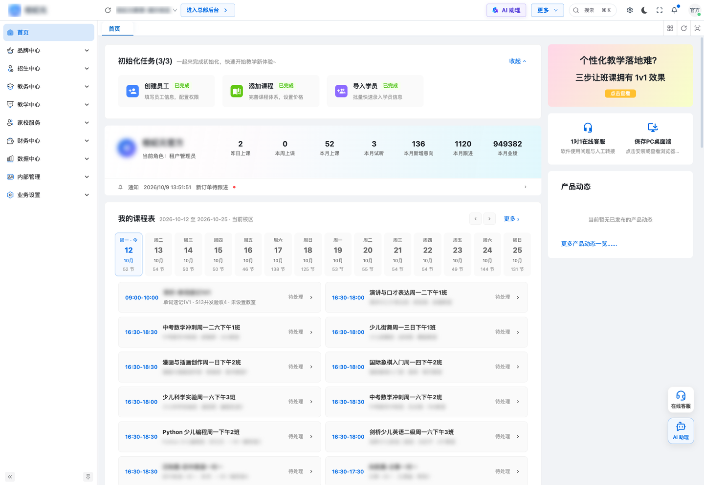
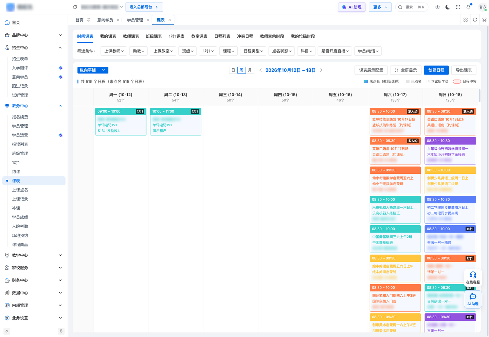
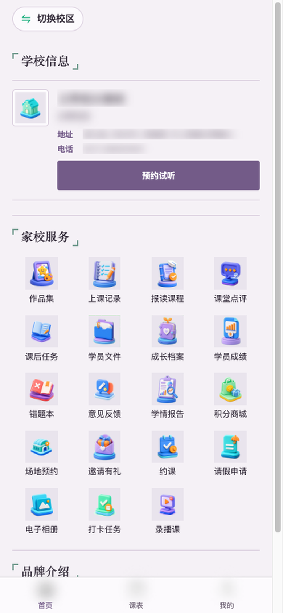
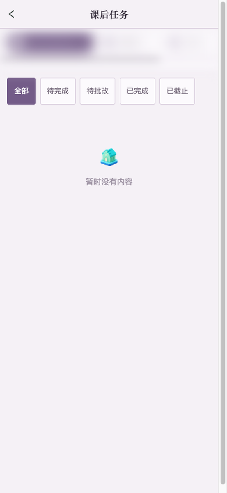

<div align="center">

# Xiaoyuan Edu (小元教培) · Management System for Training Schools

[](LICENSE)

-2B9939)

[简体中文](README.md) | English

</div>

**Xiaoyuan Edu** is a management system (SaaS) for training schools and education institutions: HQ admin console, campus admin console, campus mobile app and a parent mini-program / app / H5. It covers lead CRM & trial lessons, enrollment & payments, class scheduling, attendance & lesson consumption, parent–school communication, multi-campus management and business reports.

> **Custom development available** — features, reports, private deployment and third-party integrations can be tailored to your institution.

## What is in this repository

An **open-source lite skeleton** showing the information architecture and technical layering. It does **not** contain the full business implementation, the server, secrets, internal domains or any institution / student data.

| Directory | Content |
|---|---|
| `admin-lite/` | Campus admin console demo — Vue 3 + Vite + Ant Design Vue, mock data. Pages: Dashboard / Leads / Students / Schedule / Orders / Campuses |
| `app-lite/` | uni-app (Vue 3) sample for the campus (teacher) side and the parent side, mock data. Pages: home / schedule / students / parent home / homework |
| `docs/images/` | Architecture diagram, screenshots (demo data, masked), contact QR code |

## Product features (commercial version)

| Module | Capabilities |
|---|---|
| Admissions CRM | Leads, follow-ups, trial lesson booking & conversion, channel statistics, lead pool & assignment |
| Enrollment & payments | Enrollment, renewal / transfer / refund, discounts & installments, e-contracts, online payment & reconciliation |
| Academic affairs | Courses, classes, scheduling (group / 1-on-1), conflict detection, attendance, lesson consumption, leave & make-up |
| Parent–school | Timetable, consumption reminders, leave requests, homework & reviews, growth records, notices |
| Campus app | Today's classes, roll call, student follow-up, approvals, quick data |
| Reports | Revenue / consumption / renewal / attendance reports, staff performance |
| Multi-campus | HQ–campus hierarchy, cross-campus students & finance, roles & permissions, operation logs |

## Architecture


- Admin console: Vue 3 + Vite + Ant Design Vue
- Mobile: uni-app (Vue 3) — Android / iOS / WeChat mini-program / H5
- Server: Spring Cloud microservices + MySQL + Redis (not published)

## Quick start

```bash
cd admin-lite && npm install && npm run dev    # http://localhost:5778
cd app-lite && npm install && npm run dev:h5   # or npm run dev:mp-weixin
```

API base URL defaults to the placeholder `https://api.example.com` (`VITE_API_BASE_URL` in admin-lite, `config/index.js` in app-lite).

## Screenshots




| Campus app | Parent H5 | Homework |
|---|---|---|
|  |  |  |

More: [README.md](README.md) · [docs/README.md](docs/README.md)

## Contributing

See [CONTRIBUTING.md](CONTRIBUTING.md) and [CHANGELOG.md](CHANGELOG.md).

## Contact

- Phone: `19012779793`
- QQ: `416450997`
- Email: `416450997@qq.com`
- WeChat: scan the QR code below


## License

[MIT](LICENSE)
