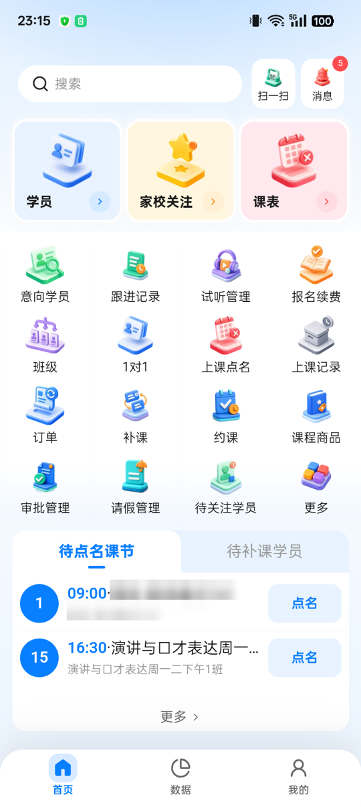
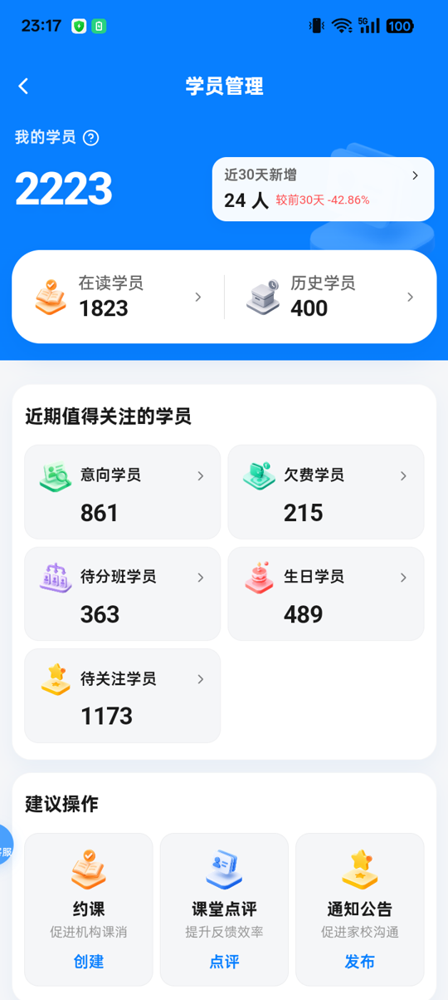
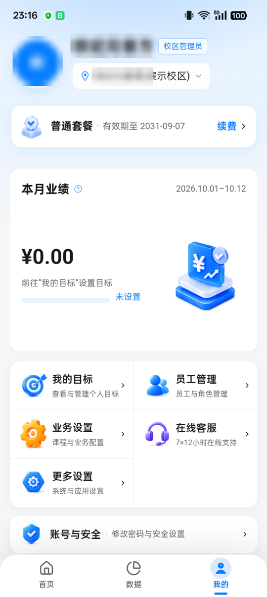
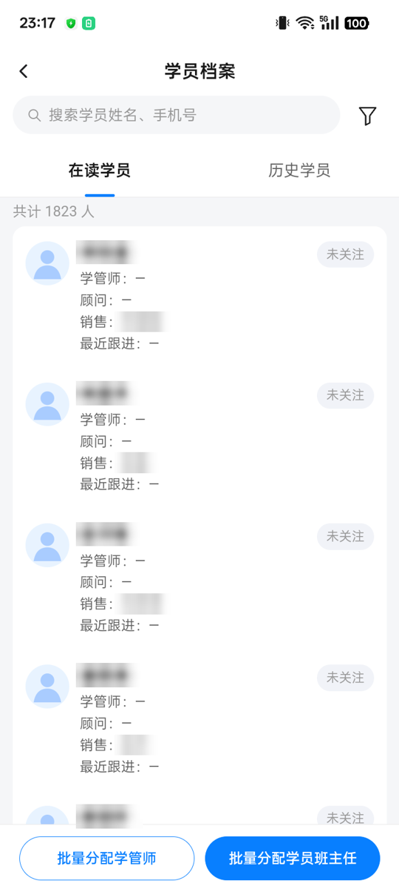
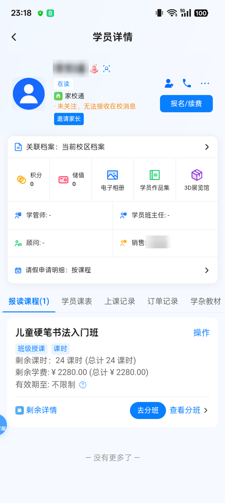
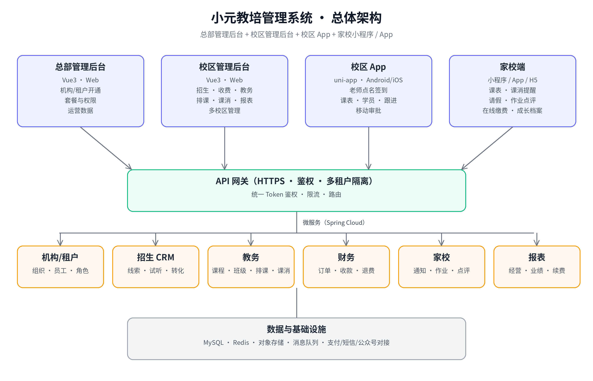
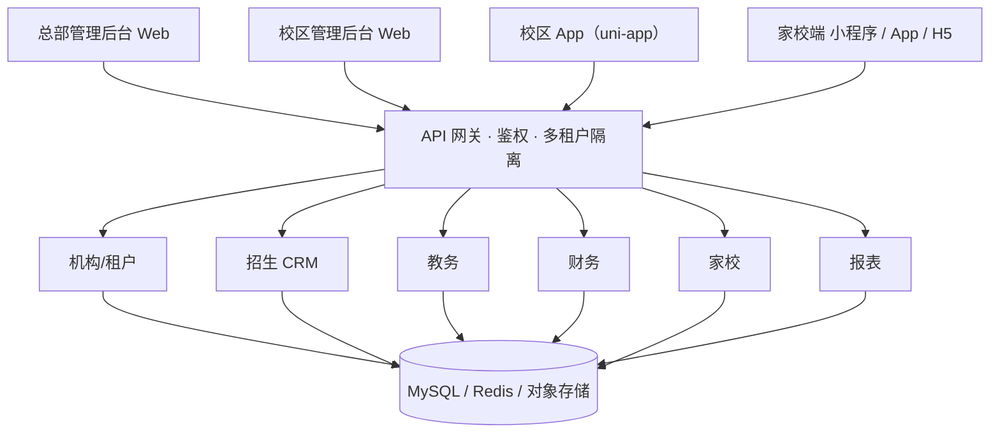

<div align="center">

# 小元教培管理系统 · 教培机构 SaaS / 校区管理 / 家校互动

**小元教培** 是一套面向培训机构的 **教培管理系统（教务管理系统）**：总部管理后台 + 校区管理后台 + 校区 App + 家校小程序/App，
覆盖 **招生 CRM、收费报名、排课点名、课消统计、家校互动、多校区管理、经营报表** 全流程。

> 🛠️ **提供定制化需求开发** — 可按机构业务流程定制教务/财务/家校功能、管理后台报表与第三方系统对接。

[核心功能](#-核心功能) · [截图](#-产品截图) · [系统架构](#-系统架构) · [同类产品](#-同类产品--替代方案) · [商务合作](#-商务合作--联系我们) · [English](#english)

</div>

---

## 📌 适用场景

K12 学科辅导、少儿英语、艺术培训（美术/音乐/舞蹈）、体育培训、编程/科创、职业教育、早教托育等 **培训机构 / 教育机构**，
单校区或 **连锁多校区** 均可使用。

## ✨ 核心功能

| 模块 | 能力 |
|---|---|
| 🎯 招生管理（CRM） | 线索/意向学员、跟进记录、试听预约与转化、渠道来源统计、公海与分配、营销获客 |
| 💰 收费报名 | 报名缴费、续费/转课/退费、优惠与分期、电子合同、在线收款与对账、业绩归属 |
| 📚 教务管理 | 课程与商品、班级管理、排课（班课/1对1）、冲突检测、点名签到、课消、请假补课、约课、教室管理 |
| 👨‍👩‍👧 家校服务 | 家长端小程序/App：课表、课消提醒、请假申请、作业布置与点评、成长档案、通知公告 |
| 📱 校区 App | 老师/校长移动办公：今日课表、点名、学员跟进、审批、数据速览 |
| 📊 经营决策 | 数据中心、收入/课消/续费/出勤报表、员工业绩、自定义维度报表 |
| 🏢 多校区管理 | 总部-校区多级组织、跨校区学员与财务、角色权限、操作日志 |
| 🌐 品牌与商城 | 机构微官网、在线商城、公众号/小程序对接 |
| 🤖 增值与对接 | AI 能力、直播/录播对接、开放接口（OpenAPI）、考勤硬件对接 |

## 🖥️ 产品截图

> 截图来自演示校区（测试数据），姓名、机构名等信息已打码。管理后台截图整理中，欢迎联系获取在线演示。

### 📱 校区 App（老师 / 校长移动端）

| 首页 · 待点名课节 | 学员管理概览 | 我的 · 业绩 |
|---|---|---|
|  |  |  |

| 学员档案列表 | 学员详情 · 报读课程 |
|---|---|
|  |  |

## 🏗️ 系统架构





- 管理后台：Vue 3 + Vite + Ant Design Vue（开源精简版见 `admin-lite/`）
- 移动端：uni-app（Vue 3），一套代码编译 Android / iOS / 微信小程序 / H5（开源精简版见 `app-lite/`）
- 服务端：Spring Cloud 微服务 + MySQL + Redis（本仓库不公开完整服务端）

## 🔍 同类产品 / 替代方案

如果你正在调研 **校宝**、**小麦助教**、**校管家**、**易知鸟** 等教培管理系统，小元教培提供同类的招生、收费、排课、家校互动与多校区管理能力，可作为 **备选方案 / 替代方案** 一并评估。
各产品各有侧重，建议结合机构规模与业务流程实际试用对比；欢迎联系我们获取演示环境。

> 以上产品名称及商标归各自权利人所有，仅用于说明产品类别，本项目与其不存在任何关联、合作或背书关系。

## 🤝 商务合作 / 联系我们

**提供定制化需求开发**：支持按机构业务定制教务/财务/家校功能、报表与权限、私有化部署、第三方系统（支付、公众号、考勤硬件、直播等）对接。

- 电话：`19012779793`
- QQ：`416450997`
- 邮箱：`416450997@qq.com`
- 微信：扫下方二维码添加


## 🏷️ 关键词

教培管理系统 · 教务管理系统 · 培训机构管理系统 · 教育机构管理软件 · 校区管理系统 · 排课系统 · 点名签到 · 课消管理 · 招生管理 · 教培 CRM · 收费管理 · 家校互动 · 家校小程序 · 多校区管理 · 连锁培训机构 · 教培 SaaS · 校宝替代 · 小麦助教替代 · 校管家替代 · 易知鸟替代

---

## 📂 开源代码结构（精简版）

本仓库公开的是**可运行的精简骨架**，用于展示信息架构与技术分层，**不包含**完整业务实现、密钥、内部域名或任何机构/学员数据。

```
xiaoyuan-edu/
├── admin-lite/      # 校区管理后台精简版（Vue3 + Ant Design Vue，Mock 数据）
│   └── src/         # layouts / router / views（经营概览、招生、学员、排课、收费、多校区）/ mock / api
├── app-lite/        # 校区端 + 家校端 uni-app 架构示例（Mock 数据）
│   ├── config/      # API_BASE_URL 占位
│   ├── api/         # 请求封装与业务接口
│   └── pages/       # 工作台 / 课表 / 学员 / 家校首页 / 作业点评
├── docs/images/     # 架构图、截图、联系二维码
├── README.md
└── LICENSE
```

### 本地运行

```bash
cd admin-lite && npm install && npm run dev   # http://localhost:5778
cd app-lite && npm install && npm run dev:h5  # 或 npm run dev:mp-weixin
```

接口地址默认为占位 `https://api.example.com`。

## English

**Xiaoyuan Edu (小元教培)** is a management system for training schools and education institutions in China: HQ admin console, campus admin console, campus mobile app and parent mini-program/app. Features include lead CRM & trial lessons, enrollment & payments, class scheduling, attendance & lesson consumption, parent–school communication, multi-campus management and business reports. It can be evaluated as an alternative to products in the same category (e.g. Xiaobao, Xiaomai Zhujiao, Xiaoguanjia, Yizhiniao); all trademarks belong to their respective owners.

**Custom development available** — we can tailor features, reports and integrations to your institution.

## License

[MIT](LICENSE)
